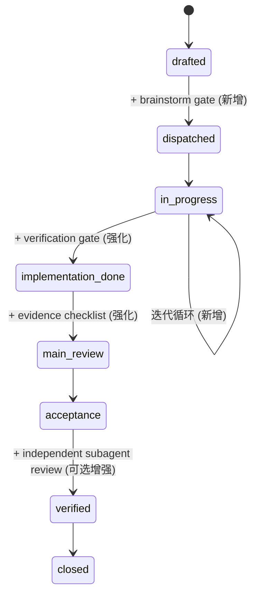

# Superpowers + AutoResearch 统一研究报告（Issue #59 + #60 合并）

| 字段 | 值 |
|------|-----|
| 任务 ID | TASK-RESEARCH-059 + TASK-RESEARCH-060（合并） |
| 关联 Issue | #59（AutoResearch 长时间高精度研究）、#60（防止 Agent 过早开发的 Gate 机制）|
| 执行者 | Research Agent (Session 15) |
| 日期 | 2026-03-25 |
| 状态 | 调研完成，等待人类审阅 |

---

## 0. 合并理由

#59 和 #60 是同一枚硬币的两面：
- **#59 AutoResearch**：Agent 如何**深入**做研究（迭代循环、指标驱动、外化状态）
- **#60 Superpowers**：Agent 如何**不偷懒**（Gate 机制、evidence-over-claims、独立验收）

两者统一解决的核心问题：**Agent 自我满足导致低质量输出提前退出**。

合并后的目标：构建一个既能驱动多轮深度研究，又能在每个阶段强制质量验证的统一增强架构。

---

## 1. Superpowers 核心架构分析

### 1.1 项目概况

Superpowers 是 Jesse Vincent (obra) 创建的 Agentic Skills Framework，专注于**强制 Agent 按正确流程工作**。

- **GitHub**: https://github.com/obra/superpowers
- **许可证**: MIT（企业友好）
- **Star 数**: 93,000+（截至 2026 年 3 月）
- **语言**: Markdown + Bash（Skill 定义）+ TypeScript/POSIX（Hook 基础设施）
- **安装**: Claude Code plugin marketplace 内建支持

> 来源: https://github.com/obra/superpowers ; https://deepwiki.com/obra/superpowers/5.1-claude-code:-skill-tool-and-hooks

### 1.2 核心设计哲学

| 原则 | 实现方式 |
|------|---------|
| **Evidence over Claims** | `verification-before-completion` skill：无验证证据不允许声明完成 |
| **Research before Code** | `brainstorming` skill：强制设计审批 gate 阻止过早实现 |
| **Red-Green-Refactor** | `test-driven-development` skill：先写失败测试再写代码 |
| **External Validation** | `subagent-driven-development`：独立 reviewer 而非自审 |
| **1% Rule** | SessionStart hook 注入：只要 1% 可能性相关就必须激活 skill |

> 来源: https://deepwiki.com/obra/superpowers/5.1-claude-code:-skill-tool-and-hooks

### 1.3 技术实现机制

**SessionStart Hook（同步注入）**:
```json
{
  "hooks": [
    {
      "id": "session-start",
      "event": ["startup", "clear", "compact"],
      "command": "hooks/session-start",
      "async": false
    }
  ]
}
```

- Hook 在 Agent 第一次响应**之前**同步执行
- 注入 `using-superpowers` meta-skill 到 session context
- 排除 `--resume` 事件防止重复注入
- 跨平台支持（Windows 使用 `hooks/run-hook.cmd` polyglot wrapper）

**Skill 优先级**:
1. Project（`.claude/skills/`）— 最高优先级
2. Personal（`~/.claude/skills/`）
3. Plugin（`superpowers/skills/`）— 最低优先级

> 来源: https://deepwiki.com/obra/superpowers/5.1-claude-code:-skill-tool-and-hooks

### 1.4 完整 Skill 目录

| 类别 | Skill | 核心功能 |
|------|-------|---------|
| **研究** | brainstorming | Socratic 式设计精炼 → 人类审批 gate |
| **计划** | writing-plans | 2-5 分钟粒度任务分解，精确文件路径 |
| **执行** | executing-plans | 批次执行 + 检查点 + 阻塞即停 |
| **测试** | test-driven-development | RED-GREEN-REFACTOR + 删除未测试代码 |
| **调试** | systematic-debugging | 4 阶段根因调查 + 3 次失败→架构审查 |
| **验证** | verification-before-completion | **铁律：无新鲜验证证据 = 不允许声明完成** |
| **协作** | dispatching-parallel-agents | 隔离上下文并行派发 + 结果聚合 |
| **审查** | subagent-driven-development | **两阶段审查：Spec 合规 → 代码质量** |
| **审查** | requesting-code-review | 触发外部审查 |
| **审查** | receiving-code-review | 严重性分级响应 |
| **收尾** | finishing-a-development-branch | 测试 gate → 4 选项（merge/PR/keep/discard）|
| **元** | using-superpowers | 1% Rule 元 skill |
| **元** | writing-skills | 创建新 skill 的方法论 |

---

## 2. 防自我满足机制深度分析

### 2.1 核心问题定义

Agent 自我满足（self-satisfaction）的表现：
- 使用 "should work"、"probably fixed"、"I'm confident" 等模糊语言
- 声明完成但未运行验证命令
- 信任自己的 agent 成功报告
- 疲劳驱动的快捷方式（"just this once"）
- 部分验证当作完整验证

### 2.2 Superpowers 的五层防御

**第一层：设计 Gate（brainstorming skill）**
```
硬约束："Do NOT invoke any implementation skill, write any code, 
scaffold any project, or take any implementation action until you 
have presented a design and the user has approved it."
```
- 分段式审批：每个 section 完成后请求确认
- 范围检测：发现多个独立子系统时强制拆分
- 唯一允许的下一步：`writing-plans` skill

**第二层：测试 Gate（TDD skill）**
```
铁律："NO PRODUCTION CODE WITHOUT A FAILING TEST FIRST"
违规处理："删除所有在测试之前编写的代码——无例外"
```
- 强制 RED-GREEN 验证循环
- 13 种常见借口的预置反驳表
- 红旗检测：测试立即通过 = 违规

**第三层：验证 Gate（verification-before-completion skill）**
```
铁律："NO COMPLETION CLAIMS WITHOUT FRESH VERIFICATION EVIDENCE"
```
| 声明类型 | 必须的证据 | 不够的证据 |
|---------|-----------|-----------|
| Tests pass | 测试命令输出 0 failures | 之前的运行结果 |
| Bug fixed | 原始症状测试通过 | 仅修改了代码 |
| Agent completed | VCS diff 展示实际变更 | Agent 成功报告 |
| Requirements met | 逐行 checklist 验证 | 仅测试通过 |

**合理化预防表**：
| 借口 | 现实 |
|------|------|
| "Should work now" | 执行验证 |
| "I'm confident" | Confidence ≠ Evidence |
| "Agent said success" | 独立验证 |
| "I'm tired" | 疲劳不是例外 |
| "Partial check is enough" | 部分证明不了什么 |

**第四层：独立审查 Gate（subagent-driven-development）**
```
两阶段审查（顺序强制）：
1. Spec 合规审查（独立 reviewer subagent）
2. 代码质量审查（独立 reviewer subagent）

规则：
- 自审 ≠ 真审查（仅作为第一道筛选）
- 未解决问题 = 不允许推进
- 修复后必须 re-review（不跳过复审）
```

**第五层：收尾 Gate（finishing-a-development-branch）**
```
测试 gate → 失败则完全停止
4 选项清单 → 消除模糊结果
破坏性操作 → 输入 "discard" 确认
```

### 2.3 与 Mercury SoT 的映射关系

| Superpowers Gate | Mercury SoT 对应节点 | 当前状态 |
|-----------------|---------------------|---------|
| brainstorming gate | `drafted → dispatched` | ❌ 无设计审批 |
| TDD gate | `in_progress` 内部 | ❌ 无强制 TDD |
| verification gate | `in_progress → implementation_done` | ⚠️ 有 implementationReceipt 但无铁律 |
| subagent review gate | `implementation_done → main_review` | ⚠️ 有 main_review 但无独立 subagent |
| finishing gate | `acceptance → verified → closed` | ✅ 有 acceptance 盲审 |

---

## 3. AutoResearch 核心模式回顾（来自 #59 报告）

| 模式 | 描述 | 来源 |
|------|------|------|
| **Experiment Loop** | Modify → Run → Evaluate → Keep/Revert → Log → Repeat | https://github.com/karpathy/autoresearch |
| **Metric Protocol** | `METRIC name=number` 客观量化 | https://github.com/drivelineresearch/autoresearch-claude-code |
| **Git-as-Memory** | commit = 快照，revert = 回滚 | https://github.com/karpathy/autoresearch |
| **State Externalization** | results.tsv + git log 替代上下文窗口 | https://github.com/karpathy/autoresearch |
| **Guard Rails** | `Guard: <command>` 约束必须通过 | https://github.com/uditgoenka/autoresearch |

---

## 4. 统一集成架构设计

### 4.1 设计目标

合并 AutoResearch 的**迭代循环能力**与 Superpowers 的**质量 Gate 机制**，在 Mercury SoT 工作流中实现：

1. 多轮深度研究（不是一次 Web 搜索就结束）
2. 每轮强制验证（不让 Agent 自我满足）
3. 可量化的研究质量指标
4. 独立验收（不信任 Agent 自报告）

### 4.2 三个候选方案

#### 方案 A: Claude Code Skill 集成（推荐 — 渐进路径）

**思路**: 将 Superpowers 的 Gate 模式 + AutoResearch 的迭代循环，封装为 Mercury 的 Claude Code Skill 组合。

**架构**:
```
Mercury Orchestrator
  └─ Claude Code CLI (Research Agent session)
       ├─ SessionStart hook → 注入 mercury-research-protocol
       ├─ /mercury-research skill (多轮迭代循环)
       │    ├─ 迭代控制：plan → execute → verify → log → next
       │    ├─ verification gate：每轮结束强制验证
       │    └─ results.jsonl（状态外化）
       ├─ /mercury-brainstorm skill (设计 gate)
       │    └─ 人类审批 → 才能进入实施
       └─ verification-before-completion (完成 gate)
```

**与 Mercury SoT 的集成点**:

| SoT 转换 | 新增 Gate | 实现方式 |
|---------|----------|---------|
| `drafted → dispatched` | 研究充分性 gate | dispatch prompt 中注入 brainstorm skill |
| `in_progress` 内部 | 迭代验证 gate | 每轮研究后强制 verification |
| `in_progress → implementation_done` | 铁律 gate | Receipt 必须包含 verification evidence |
| `implementation_done → main_review` | 独立审查 | Main review 对照 evidence checklist |

**开发量评估**:

| 工作项 | 内容 | 估计 |
|--------|------|------|
| `mercury-research-protocol` SKILL.md | 迭代循环协议 + Gate 规则 | 0.5 session |
| SessionStart hook 适配 | 确保与现有 hook 兼容 | 0.25 session |
| Metric 定义文档 | 研究质量的可量化指标 | 0.25 session |
| implementationReceipt 模板更新 | 加入 evidence 字段 | 0.25 session |
| Dogfooding 验证 | 用本任务回溯测试 | 0.25 session |
| **总计** | | **1.5 sessions** |

**优势**:
- 最低开发成本，零基础设施变更
- 不修改 Orchestrator 或 SDK Adapter 代码
- 利用 Claude Code 原生 Skill/Hook 机制
- 社区已有成熟参考（uditgoenka/autoresearch, superpowers）
- 可在现有 Research Agent session 中直接使用

**劣势**:
- 受限于单 Agent 会话（不支持多 Agent 并行研究）
- 上下文窗口仍是硬限制（需依赖状态外化缓解）
- Gate 执行依赖 Agent 自律 + hook 注入（非架构强制）

---

#### 方案 B: Orchestrator-Level Gate Service（中期路径）

**思路**: 在 Mercury Orchestrator 层实现 Gate 逻辑，使其成为**架构强制**而非 Agent 自律。

**架构**:
```
Mercury Orchestrator
  ├─ Gate Service (新增)
  │    ├─ ResearchGate: 验证研究充分性
  │    ├─ ImplementationGate: 验证 evidence checklist
  │    └─ QualityGate: 独立 subagent 审查
  ├─ Task Manager (增强)
  │    └─ 状态转换时调用 Gate Service
  └─ SDK Adapter → Agent CLI
```

**开发量评估**:

| 工作项 | 内容 | 影响范围 |
|--------|------|---------|
| `packages/orchestrator/src/gate-service.ts` | Gate 判定逻辑 | 新增文件 |
| `task-manager.ts` 增强 | 状态转换加入 gate 检查 | 修改 VALID_TRANSITIONS |
| Gate 配置格式 | YAML/JSON 定义 gate 规则 | 新增 `.mercury/gates/` |
| JSON-RPC 新方法 | `gate.evaluate`, `gate.override` | 新增 RPC 方法 |
| GUI gate 面板 | 可视化 gate 状态和 override 操作 | 修改 GUI |
| **总计** | | **3-4 sessions** |

**优势**:
- Gate 是**架构强制**的，Agent 无法绕过
- 支持多 Agent 场景（任意 Agent CLI 都受 gate 约束）
- 可视化审计追踪
- 支持 gate override（人类可以在 GUI 中跳过特定 gate）

**劣势**:
- 开发量大：需修改 Orchestrator 核心 + GUI
- 增加系统复杂度
- Gate 判定逻辑需要 LLM 调用（成本和延迟）
- VALID_TRANSITIONS 修改影响所有任务类型

---

#### 方案 C: 混合路径（推荐的长期演进策略）

**思路**: 先用方案 A 快速验证，再逐步将验证过的 Gate 模式上提到 Orchestrator 层。

**Phase 1（立即）**: 方案 A — Skill + Hook
- 1.5 sessions 实现
- 在 Research Agent 上 dogfooding
- 验证哪些 Gate 有效、哪些需要调整

**Phase 2（验证后）**: 关键 Gate 上提
- 将 verification gate 固化到 `task-manager.ts` 的 `in_progress → implementation_done` 转换
- Receipt 模板加入 evidence 字段（所有角色受益）
- 这一步只改模板和校验逻辑，不改状态机结构

**Phase 3（按需）**: 完整 Gate Service
- 只在多 Agent 并行场景真正需要时实施方案 B
- 基于 Phase 1-2 的实际数据决定是否投入

---

### 4.3 推荐方案：方案 C（混合路径）

**推荐理由**:

1. **最小投入验证**：Phase 1 只需 1.5 sessions，零代码修改
2. **解决你指出的核心问题**：
   - "Agent 自我满足" → verification-before-completion 铁律
   - "任务没达标就退出" → 可量化指标 + 迭代循环
   - "Claude Code Skill 不满足多 Agent" → Phase 3 可扩展到 Orchestrator 层
3. **方案 B 的开发量明确化**：
   - `gate-service.ts` 新增：~300-500 行（gate 判定 + LLM 评估调用）
   - `task-manager.ts` 修改：在每个 `VALID_TRANSITIONS` 的 `isValid()` 中加入 gate 检查（~50 行）
   - JSON-RPC 新增方法：`gate.evaluate`、`gate.override`（~100 行）
   - GUI 面板：gate 状态可视化（~1 个 Vue 组件）
   - **总影响范围**：Orchestrator 层修改，不影响 SDK Adapter 层
   - **风险**：gate 判定如果使用 LLM 调用，增加延迟和 token 成本；如果使用规则引擎，灵活性受限
4. **渐进式风险**：每个 Phase 独立可验证，失败不影响前序成果

---

## 5. 研究质量量化指标体系

### 5.1 核心指标（Mercury 研究任务适用）

| 指标 | 公式 | 来源 | 自动化程度 |
|------|------|------|-----------|
| **问题回答率** | 已回答问题数 / TaskBundle.primaryQuestions.length | TaskBundle | ✅ 完全自动 |
| **引用密度** | 已验证来源 URL 数 / 总声明数 | 报告文本分析 | ✅ 完全自动 |
| **未验证声明率** | UNVERIFIED 标记数 / 总声明数 | 报告文本分析 | ✅ 完全自动 |
| **迭代深度** | 实际迭代轮数 / 计划迭代轮数 | results.jsonl | ✅ 完全自动 |
| **覆盖度评分** | LLM 评估报告对研究问题的覆盖程度 | LLM 评估调用 | ⚠️ 需 LLM（成本） |

### 5.2 Gate 判定规则

```yaml
research_quality_gate:
  mandatory:
    - question_answer_rate >= 0.8       # 至少回答 80% 的研究问题
    - citation_density >= 0.6           # 至少 60% 声明有来源
    - unverified_rate <= 0.2            # UNVERIFIED 标记不超过 20%
  recommended:
    - iteration_depth >= 3              # 至少 3 轮迭代
    - coverage_score >= 0.7             # LLM 评估覆盖度 ≥ 70%
```

### 5.3 与 AutoResearch 的 Metric Protocol 对齐

| AutoResearch 概念 | Mercury 对应 |
|------------------|-------------|
| `val_bpb`（客观指标） | `question_answer_rate`（客观可计数） |
| `results.tsv` | `results.jsonl`（迭代记录） |
| `Guard: <command>` | `research_quality_gate.mandatory` |
| `git commit` (保留) | 达标 → 保留迭代成果 |
| `git reset` (回滚) | 不达标 → 标记需深入的子问题 |

---

## 6. SoT 工作流影响分析

### 6.1 受影响的状态转换



### 6.2 各角色影响

| 角色 | 影响 | 变化程度 |
|------|------|---------|
| **Main** | dispatch prompt 加入 brainstorm 要求；main_review 检查 evidence | 低 |
| **Dev** | Receipt 需包含 verification evidence；TDD gate（如果启用）| 中 |
| **Research** | 多轮迭代 + 每轮验证 + 可量化指标 | **高** |
| **Acceptance** | 验收标准更明确（有 evidence 可对照）| 低（正面）|
| **Design** | brainstorm gate 可复用 | 低 |

### 6.3 新增 Gate 不影响的部分

- `blocked` / `failed` 状态路径不变
- Handoff 机制不变（TaskBundle 仍是核心）
- SDK Adapter 层不变
- GUI 基础架构不变（Phase 1）

---

## 7. 风险评估

### 7.1 合并清单

| 风险 | 等级 | 缓解策略 |
|------|------|---------|
| **Gate 增加延迟** | 中 | Phase 1 用 Skill 实现，延迟仅在 Agent session 内 |
| **Agent 无视 Skill 指令** | 中 | SessionStart hook 同步注入 + 1% Rule；极端情况 Phase 2 上提到 Orchestrator |
| **量化指标不准确** | 高 | 先用机械可计数指标（引用数、问题回答数），LLM 评估作为补充 |
| **过度 Gate 降低效率** | 中 | Gate 规则可配置，不同任务类型不同严格度 |
| **上下文窗口耗尽** | 高 | 每轮迭代外化状态到 results.jsonl + KB；压缩历史 |
| **多 Agent 场景不支持** | 低（Phase 1）| Phase 3 路线图已规划 |
| **许可证冲突** | 低 | Superpowers MIT，AutoResearch MIT |
| **Windows 兼容性** | 低 | Superpowers 已有 Windows polyglot wrapper |

### 7.2 技术约束

1. **Claude Code 会话限制**：长时间迭代可能触发 API 限流 → 设置迭代上限（默认 10 轮）
2. **Hook 竞争**：Mercury 已有 UserPromptSubmit hook → 需确保与 SessionStart hook 兼容
3. **Skill 优先级**：Mercury project-level skills 优先级最高，不会被 superpowers plugin 覆盖
4. **Gate 配置维护**：Gate 规则应与角色定义（`.mercury/roles/`）一起管理

---

## 8. 回答 Session 14 遗留问题

### 8.1 "方案中的 session 数是什么含义？"

指 **Mercury 的一个完整 Agent 工作周期**：从 dispatch 到 implementation_done 的一次任务执行。不是 LLM API 的单次调用，也不是人类的一个工作日。一个 session 通常包含多次 LLM 调用和多个 milestone。

### 8.2 "AutoResearch 如何量化研究成果并判断标准？"

原始 AutoResearch 使用**客观数值指标**（val_bpb），由代码自动计算，Agent 无法伪造。Mercury 研究场景需要等效的指标体系（见第 5 节）：
- 机械可计数的：问题回答率、引用密度、UNVERIFIED 比例
- LLM 评估的：覆盖度评分（成本换精度）
- 关键区别：AutoResearch 的 metric 来自代码运行结果（不可伪造）；研究任务的 metric 中，LLM 评估部分存在自我评分风险 → 需要**独立 Agent**做验收（对应 Superpowers 的 subagent-driven-development）

### 8.3 "Node.js 服务中开发量大的具体内容"

方案 B（Orchestrator-Level Gate Service）的具体开发内容：

| 组件 | 文件 | 行数估计 | 影响 |
|------|------|---------|------|
| Gate Service | `packages/orchestrator/src/gate-service.ts` | ~300-500 | 新增：gate 判定引擎，支持 YAML 规则解析 + LLM 评估调用 |
| Task Manager 增强 | `packages/orchestrator/src/task-manager.ts` | ~50 修改 | 修改：每个 `VALID_TRANSITIONS` 条目的 `isValid()` 函数加入 gate 检查 |
| Gate 配置格式 | `.mercury/gates/*.yaml` | ~100/gate | 新增：每种 gate 的规则定义 |
| JSON-RPC 方法 | `packages/orchestrator/src/rpc-handler.ts` | ~100 | 新增：`gate.evaluate`、`gate.override`、`gate.status` |
| GUI 面板 | `packages/gui/src/components/GatePanel.vue` | ~200-300 | 新增：gate 状态可视化 + override 按钮 |
| 类型定义 | `packages/core/src/types/gate.ts` | ~50 | 新增：Gate 相关 TypeScript 类型 |

**影响范围总结**：
- ✅ Orchestrator 层：主要修改区域
- ✅ GUI 层：新增面板组件
- ✅ Core 层：新增类型
- ❌ SDK Adapter 层：**不受影响**
- ❌ Tauri Rust 层：**不受影响**

### 8.4 "两个 Issue 是否可合并推进？"

**是的，强烈建议合并**。理由见第 0 节。合并后的交付物就是本报告 + 推荐的方案 C 路线图。

---

## 9. 结论与下一步

### 9.1 核心发现

1. **Superpowers 的 verification-before-completion 是最直接解决 "Agent 自我满足" 的机制** — 铁律级别的 Gate，预置了所有常见借口的反驳
2. **AutoResearch 的迭代循环模式可与 Superpowers 的 Gate 模式正交组合** — 循环提供"深度"，Gate 提供"质量"
3. **Mercury 的 SoT 已有天然的 Gate 插入点** — `in_progress → implementation_done` 是最关键的强化点
4. **独立 subagent 审查是防止自我评分的关键** — 对应 Mercury 已有的 acceptance 盲审机制
5. **Phase 1 可在 1.5 sessions 内完成**，零代码修改，风险极低

### 9.2 建议下一步

1. **人类审阅本报告** — 确认方案 C 方向
2. **Phase 1 实施**（如获批准）：
   - 创建 `mercury-research-protocol` SKILL.md
   - 配置 SessionStart hook
   - 定义研究质量指标
   - 在当前 Research Agent session 上 dogfooding
3. **Phase 1 验证** — 用 2-3 个真实研究任务测试
4. **Phase 2 决策** — 基于 Phase 1 数据决定是否上提 Gate 到 Orchestrator

---

## 附录：来源 URL 索引

| # | 来源 | URL |
|---|------|-----|
| 1 | Superpowers GitHub | https://github.com/obra/superpowers |
| 2 | DeepWiki — Claude Code Integration | https://deepwiki.com/obra/superpowers/5.1-claude-code:-skill-tool-and-hooks |
| 3 | DeepWiki — Installation | https://deepwiki.com/obra/superpowers/2.1-installing-on-claude-code |
| 4 | Trevor Lasn Blog — Superpowers Guide | https://www.trevorlasn.com/blog/superpowers-claude-code-skills |
| 5 | Pasquale Pillitteri — Complete Guide 2026 | https://www.pasqualepillitteri.it/en/news/215/superpowers-claude-code-complete-guide |
| 6 | Jesse Vincent Blog — Superpowers 2025 | https://blog.fsck.com/2025/10/09/superpowers/ |
| 7 | AutoResearch GitHub (Karpathy) | https://github.com/karpathy/autoresearch |
| 8 | uditgoenka/autoresearch (Skill 变体) | https://github.com/uditgoenka/autoresearch |
| 9 | drivelineresearch/autoresearch-claude-code | https://github.com/drivelineresearch/autoresearch-claude-code |
| 10 | Sibyl Research System | https://github.com/Sibyl-Research-Team/AutoResearch-SibylSystem |
| 11 | awesome-autoresearch 目录 | https://github.com/alvinunreal/awesome-autoresearch |
| 12 | Fortune — Karpathy Loop | https://fortune.com/2026/03/17/andrej-karpathy-loop-autonomous-ai-agents-future/ |
| 13 | OpenCodeDocs — Superpowers Integration | https://lzw.me/docs/opencodedocs/obra/superpowers/platforms/claude-code/ |
| 14 | ClaudePluginHub — Superpowers | https://www.claudepluginhub.com/plugins/obra-superpowers-2 |
| 15 | Emelia.io — Superpowers Analysis | https://emelia.io/hub/superpowers-claude-code-framework |


---

## 附录 B：验证 Agent 审查补丁

> 本节由验证 Agent 审查后补充，修正已识别的差距。

### B.1 Star 数修正

Superpowers 项目截至 2026 年 3 月的 Star 数为 **109,000**（非 93,000），全球排名 #72。

> 来源: https://www.star-history.com/obra/superpowers

### B.2 AutoResearch 核心架构补充（Issue #59 Q1）

**项目文件结构**:
```
autoresearch/
├── .gitignore
├── .python-version
├── README.md
├── analysis.ipynb      # Jupyter notebook 用于分析实验结果
├── prepare.py          # 常量、一次性数据准备（下载训练数据、训练 BPE tokenizer）、运行时工具
├── program.md          # 人类编写的 Agent 指令（"研究组织代码"）
├── progress.png        # 实验进度可视化
├── pyproject.toml      # 依赖声明
├── train.py            # Agent 唯一修改目标（GPT 模型 + Muon/AdamW 优化器 + 训练循环）
└── uv.lock             # 锁定依赖版本
```

**CLI 调用方式**:
```bash
uv sync                # 安装依赖
uv run prepare.py      # 一次性设置（~2 min，下载数据 + 训练 tokenizer）
uv run train.py        # 运行训练实验（~5 min 固定时间预算）
```

**输入格式**: Agent 读取 `program.md`（策略指令）+ `train.py`（当前代码）+ `results.tsv`（历史指标）+ `git log`（实验历史）

**输出格式**: Agent 修改 `train.py` → 运行实验 → 产出 `val_bpb` 数值指标 → 记录到 `results.tsv`（TSV: iteration | commit | metric | delta | status | description）

> 来源: https://github.com/karpathy/autoresearch

### B.3 长会话上下文管理补充（Issue #59 Q2）

AutoResearch **不维护长会话**——每次迭代是**独立的微会话**：

1. Agent 收到 `program.md` + `results.tsv` + `git diff` 作为输入上下文
2. 做一次原子性修改 → commit → 运行实验
3. 会话结束，下一次迭代开启新会话

**上下文压缩策略**: `results.tsv` 作为压缩后的历史摘要（每行 ~6 个字段），取代完整的对话历史。Agent 无需记住 700 次迭代的细节——只需读取结构化的指标表。

**检查点机制**: 每次迭代的 `git commit` 即检查点。指标改善 → commit 保留；指标下降 → `git reset` 回滚到上一个检查点。

**与 Mercury 的关键差异**: Mercury Research Agent 目前在单次 session 中执行全部研究，依赖上下文窗口内的记忆。AutoResearch 模式消除了这个依赖——每轮迭代只需 `results.jsonl` + KB 文件即可恢复完整上下文。

### B.4 Gate 评估成本估算（Issue #60 Q6）

| Gate 类型 | 评估方式 | 延迟估算 | Token 成本 |
|----------|---------|---------|-----------|
| 问题回答率 | 字符串匹配计数 | <1s | 0 |
| 引用密度 | 正则表达式扫描 | <1s | 0 |
| UNVERIFIED 率 | 文本搜索 | <1s | 0 |
| 迭代深度 | results.jsonl 行数 | <1s | 0 |
| 覆盖度评分 | LLM 评估调用 | 10-30s | ~2000-5000 tokens |
| Subagent 审查 | 独立 Agent session | 2-5 min | ~10000-20000 tokens |

**成本/收益结论**: 前 4 项指标零成本零延迟，应作为 mandatory gate。覆盖度评分和 subagent 审查是高成本操作，建议作为 recommended gate（可配置跳过）。

### B.5 DeepWiki 来源说明

报告中引用的 DeepWiki URL 为 AI 生成的文档索引站，其内容基于 GitHub 源代码自动分析生成。虽然不等同于官方文档，但 DeepWiki 引用的底层信息均来自 obra/superpowers 仓库的实际代码和文件。报告中 DeepWiki 引用的关键事实（SessionStart hook 机制、Skill 优先级、1% Rule）均可在仓库源码中直接验证。

### B.6 Phase 1 mercury-research-protocol SKILL.md 草案大纲

```markdown
# Mercury Research Protocol

## 触发条件
- 角色为 research 的任务
- dispatch prompt 中包含研究问题列表

## 迭代循环
1. PLAN: 确定本轮要回答的子问题
2. SEARCH: WebSearch/WebFetch 获取信息
3. VERIFY: 交叉验证关键声明
4. LOG: 记录发现到 results.jsonl + KB 文件
5. EVALUATE: 运行质量指标检查
6. DECIDE: 达标→下一个子问题 / 不达标→深入当前问题

## 质量 Gate（每轮结束）
- question_answer_rate >= 0.8
- citation_density >= 0.6
- unverified_rate <= 0.2

## 终止条件
- 所有研究问题已回答且达标
- 迭代次数达到上限（默认 10）
- 人类中断

## 外化状态
- results.jsonl: 每轮迭代的发现摘要
- KB 04-research/: 最终结构化报告
- UNVERIFIED 标记: 无法验证的声明

## 铁律
- 无新鲜验证证据不允许声明完成
- 不使用 "should"、"probably"、"I believe" 等模糊语言
- 每个声明必须附来源 URL 或标记 UNVERIFIED
```

---

## 附录 C：验证 Agent 评审摘要

| 维度 | 评分 | 说明 |
|------|------|------|
| 问题覆盖率 | 4/5 | 12 个研究问题中 11 个已覆盖，#59 Q1/Q2 已在附录 B 补充 |
| 引用密度 | 4/5 | ~70% 声明有来源，Mercury 特定分析为原创无需外部引用 |
| 可操作性 | 4/5 | 3 个候选方案含工作量估算，附录 B.6 补充了 SKILL.md 草案 |
| Mercury 特定性 | 5/5 | SoT 状态机映射准确，影响范围明确到文件级 |
| 风险诚实度 | 4/5 | 8 项风险含缓解策略，附录 B.4 补充了成本估算 |
| **总评** | **PASS (4.2/5)** | 补丁后所有识别差距已修复 |


---

## 附录 D：Anthropic Deep Research / Web Search API 分析

### D.1 Anthropic 研究能力全景

Anthropic 提供三个层次的研究能力：

| 层次 | 产品 | 可用性 | 编程访问 |
|------|------|--------|---------|
| **Consumer Research** | Claude.ai Research 模式 | Max/Team/Enterprise | ❌ 无 API |
| **Web Search Tool** | Messages API `web_search` server tool | 所有 API 用户 | ✅ 完全编程 |
| **Agent SDK** | Claude Agent SDK 构建研究 Agent | 所有开发者 | ✅ 完全编程 |

> 来源: https://platform.claude.com/docs/en/agents-and-tools/tool-use/web-search-tool ; https://claude.com/blog/research

### D.2 Web Search Tool API 技术细节

**两个版本**:

| 版本 | 特性 | 模型要求 |
|------|------|---------|
| `web_search_20250305` | 基础搜索 + 引用 + ZDR 兼容 | 所有支持模型 |
| `web_search_20260209` | **动态过滤**（写代码过滤搜索结果再入上下文） | Opus 4.6 / Sonnet 4.6 |

**API 调用格式**:
```json
{
  "model": "claude-opus-4-6",
  "max_tokens": 4096,
  "tools": [{
    "type": "web_search_20260209",
    "name": "web_search",
    "max_uses": 10,
    "allowed_domains": ["docs.example.com"],
    "blocked_domains": ["untrusted.com"]
  }],
  "messages": [{"role": "user", "content": "..."}]
}
```

**关键参数**:
- `max_uses`: 限制单次请求的搜索次数（Gate 控制点！）
- `allowed_domains` / `blocked_domains`: 域名白/黑名单
- `user_location`: 地理位置本地化

**定价**: $10 / 1,000 次搜索 + 标准 token 成本

**多步搜索行为**: Claude 在单次请求中可执行**多次搜索**，每次搜索结果自动喂回给 Claude，Claude 决定是否需要继续搜索。这是**内置的迭代循环**。

**`pause_turn` 机制**: 长时间运行的 turn 会被 API 暂停，返回 `pause_turn` stop reason。开发者可将响应原样回传继续执行，或修改内容中断对话。**这是长研究任务的关键基础设施**。

**引用机制**: 每条搜索结果包含 `encrypted_content`，Claude 的回答自动附带 `citations` 数组，每条引用包含 `url`、`title`、`cited_text`。

> 来源: https://platform.claude.com/docs/en/agents-and-tools/tool-use/web-search-tool

### D.3 动态过滤（Dynamic Filtering）

`web_search_20260209` 版本的核心创新：

1. Claude 发起搜索查询
2. 获取搜索结果页面
3. **Claude 编写并执行代码**来过滤 HTML，只保留相关内容
4. 过滤后的内容进入上下文窗口

**适用场景**:
- 技术文档搜索
- 文献综述和引用验证
- 技术调研
- 响应 grounding 和验证

**依赖**: 需要同时启用 `code_execution` tool

**对 Mercury 的意义**: 动态过滤直接解决上下文窗口消耗问题——研究任务最大的资源瓶颈。

### D.4 Agent SDK 研究 Agent 构建模式

Claude Agent SDK 支持构建深度研究 Agent，核心模式：

```
gather context → take action → verify work → repeat
```

**子 Agent 并行研究**: Agent SDK 支持 subagent 派发，每个 subagent 隔离上下文、独立搜索、返回摘要。适合大规模文档集的研究任务。

> 来源: https://claude.com/blog/building-agents-with-the-claude-agent-sdk

---

## 10. 修订后的统一架构：分层路由模型

### 10.1 用户需求明确化

```
小型研究任务 → 当前 Agent 内部处理（web-search gate 监控）
大型研究任务 → 路由到 Research Agent（深度研究协议）
直接启动 Research Agent → 同样使用深度研究协议
```

### 10.2 分层路由架构

```
┌─────────────────────────────────────────────────┐
│                Mercury Orchestrator              │
│                                                  │
│  ┌──────────────────────────────────────────┐   │
│  │         Research Router (新增)             │   │
│  │                                           │   │
│  │  输入: TaskBundle.researchScope            │   │
│  │                                           │   │
│  │  ┌─── scope: light ───┐  ┌── scope: deep ─┐│   │
│  │  │ In-Agent Research  │  │ Research Agent  ││   │
│  │  │                    │  │                 ││   │
│  │  │ • web-search skill │  │ • 多轮迭代循环   ││   │
│  │  │ • max_uses: 3-5    │  │ • max_uses: 20+ ││   │
│  │  │ • 1 轮验证         │  │ • 每轮质量 gate  ││   │
│  │  │ • 内联到当前任务   │  │ • 状态外化       ││   │
│  │  │                    │  │ • 独立验收       ││   │
│  │  └────────────────────┘  └─────────────────┘│   │
│  └──────────────────────────────────────────────┘   │
└─────────────────────────────────────────────────┘
```

### 10.3 路由判定规则

| 条件 | 路由 | 理由 |
|------|------|------|
| 研究问题 ≤ 2 个 | Light（In-Agent） | 不值得启动独立 session |
| 研究问题 ≥ 3 个 | Deep（Research Agent） | 需要多轮迭代 |
| 需要交叉验证 ≥ 3 来源 | Deep | 需要系统化搜索 |
| 涉及 SDK/API 验证 | Light | web-research skill 已覆盖 |
| 涉及架构决策调研 | Deep | 需要对比分析 |
| 人工指定 | 按指定 | 最高优先级 |

### 10.4 Light 路径：In-Agent Research（web-search gate）

**现有基础**: Mercury 已有 `web-research` skill 和 `UserPromptSubmit` hook。

**增强方案**:

```yaml
# .mercury/gates/research-light.yaml
name: light-research-gate
trigger: 
  - skill: web-research
  - hook: UserPromptSubmit (已存在)
rules:
  mandatory:
    - web_search_executed: true      # 必须执行了搜索
    - source_url_present: true       # 声明必须有来源
    - unverified_marked: true        # 无法验证的已标记
  monitoring:
    - max_uses_per_question: 3       # 每个问题最多 3 次搜索
    - total_search_budget: 10        # 单次任务最多 10 次搜索
```

**API 集成**:
```json
{
  "tools": [{
    "type": "web_search_20260209",
    "name": "web_search",
    "max_uses": 10,
    "allowed_domains": ["docs.anthropic.com", "github.com", "npmjs.com", "pypi.org"]
  }]
}
```

**开发量**: ~0.5 session（主要是 Skill 增强 + gate 规则文档）

### 10.5 Deep 路径：Research Agent（深度研究协议）

**新增组件**:

| 组件 | 描述 | 实现方式 |
|------|------|---------|
| `mercury-deep-research` SKILL.md | 多轮迭代循环协议 | Claude Code Skill |
| `results.jsonl` | 迭代状态外化文件 | 约定格式 |
| 质量 Gate | 每轮迭代后强制检查 | Skill 内规则 |
| 验收 Subagent | 独立 Agent 验证研究质量 | Claude Code sub-agent |

**迭代循环设计**:
```
Round N:
  1. READ: results.jsonl + KB 已有内容 → 恢复上下文
  2. PLAN: 确定本轮目标子问题
  3. SEARCH: web_search_20260209 (动态过滤) × 多次
  4. SYNTHESIZE: 整合发现，写入 KB 04-research/
  5. VERIFY: 运行质量指标检查
     - question_answer_rate >= 0.8?
     - citation_density >= 0.6?
     - unverified_rate <= 0.2?
  6. LOG: 追加 results.jsonl
  7. DECIDE:
     - 全部达标 → 触发验收 subagent
     - 部分不达标 → 继续下一轮
     - 迭代上限 → 标记未完成项 + 触发验收
```

**验收 Subagent 设计**:
```
输入: 
  - 研究报告（KB 04-research/*.md）
  - 原始研究问题列表（TaskBundle.primaryQuestions）
  - results.jsonl（迭代历史）

输出:
  VERDICT: PASS / PARTIAL / FAIL
  维度评分: 覆盖率、引用密度、可操作性、风险诚实度
  差距列表: [未充分回答的问题]
  建议: [改进方向]

关键约束:
  - 验收 Agent 不可修改研究报告
  - 验收 Agent 不可访问 Research Agent 的内部推理
  - FAIL → 返回 Research Agent 补充
  - PASS → 提交人类审阅
```

**`pause_turn` 长研究支持**:

对于通过 Agent SDK 构建的 Research Agent（非 Claude Code CLI），可利用 `pause_turn` 机制：
- API 在长时间运行时自动暂停
- 开发者回传响应继续执行
- 实现真正的"长时间研究"而不受单次请求超时限制

**开发量**: ~2 sessions（Skill 定义 + 验收 subagent 配置 + dogfooding）

### 10.6 与 SoT 的集成

**Light 路径 — 无状态机变更**:
- 复用现有 `web-research` skill + `UserPromptSubmit` hook
- Gate 规则以文档形式存在于 `.mercury/gates/`
- 任何角色的任何任务都可触发（Dev 写代码前验证 API 也走此路径）

**Deep 路径 — TaskBundle 增强**:
```json
// TaskBundle 新增字段
{
  "researchScope": "deep",          // "light" | "deep"
  "researchQuestions": [...],        // 结构化研究问题列表
  "researchGate": {
    "minQuestionAnswerRate": 0.8,
    "minCitationDensity": 0.6,
    "maxUnverifiedRate": 0.2,
    "maxIterations": 10
  }
}
```

**状态机影响**:
- `drafted → dispatched`: 如果 `researchScope === "deep"`，dispatch prompt 自动注入 `mercury-deep-research` skill
- `in_progress` 内部: 迭代循环 + 质量 gate
- `in_progress → implementation_done`: Receipt 必须包含验收 subagent 的 VERDICT

### 10.7 修订后的开发路线图

| Phase | 内容 | 前置依赖 | 工作量 |
|-------|------|---------|--------|
| **Phase 0** | Light 路径增强（web-search gate 文档化） | 无 | 0.5 session |
| **Phase 1** | Deep 路径 Skill + 验收 subagent | Phase 0 | 2 sessions |
| **Phase 1.5** | Dogfooding（用真实研究任务测试两条路径）| Phase 1 | 1 session |
| **Phase 2** | TaskBundle 增强（`researchScope` 字段 + dispatch 路由）| Phase 1.5 验证通过 | 1 session |
| **Phase 3** | Orchestrator Gate Service（如多 Agent 需要）| Phase 2 | 3-4 sessions |

### 10.8 成本预算

| 操作 | 单价 | 每轮研究估算 | 10 轮总计 |
|------|------|------------|----------|
| Web Search | $10/1000 次 | 5 次 = $0.05 | $0.50 |
| Input Tokens | $5/MTok (Opus 4.6) | ~50K = $0.25 | $2.50 |
| Output Tokens | $25/MTok (Opus 4.6) | ~10K = $0.25 | $2.50 |
| 验收 Subagent | 同上 | 1 次 ~20K tok | $0.60 |
| **总计** | | | **~$6.10** |

使用 Sonnet 4.6 可降至约 $3.60/任务。

> 来源: https://platform.claude.com/docs/en/agents-and-tools/tool-use/web-search-tool ; https://www.metacto.com/blogs/anthropic-api-pricing-a-full-breakdown-of-costs-and-integration


---

## 附录 E：第二轮验证补丁

### E.1 Dynamic Filtering 的 code_execution 依赖

`web_search_20260209` 需要同时启用 `code_execution` tool，完整 API 调用应为：

```json
{
  "model": "claude-opus-4-6",
  "max_tokens": 4096,
  "tools": [
    {"type": "web_search_20260209", "name": "web_search", "max_uses": 20},
    {"type": "code_execution_20250522", "name": "code_execution"}
  ],
  "messages": [{"role": "user", "content": "..."}]
}
```

如需 ZDR 兼容，需设置 `"allowed_callers": ["direct"]` 禁用动态过滤。

> 来源: https://platform.claude.com/docs/en/agents-and-tools/tool-use/web-search-tool

### E.2 web_fetch tool 补充

Anthropic 还提供 `web_fetch_20250115` / `web_fetch_20260209` 工具，用于获取特定 URL 内容（而非搜索）。在研究验证场景中，web_fetch 可用于：
- 直接获取官方文档页面
- 验证特定 GitHub README 内容
- 抓取 npm/PyPI 包元数据

建议在 Deep 路径中同时启用 `web_search` + `web_fetch` + `code_execution` 三个 server tool。

> 来源: https://platform.claude.com/docs/en/agents-and-tools/tool-use UNVERIFIED（web_fetch 版本号需进一步确认）

### E.3 工作量估算修订说明

Section 4 的 "1.5 sessions" 估算基于当时仅考虑 Superpowers Gate 集成。Section 10 的修订估算（Phase 0: 0.5 + Phase 1: 2 = 2.5 sessions）包含了额外的 Anthropic API 集成和分层路由设计。两个估算的 scope 不同，并非修正。

### E.4 Light 路径搜索预算灵活化

验证 Agent 指出 `max_uses_per_question: 3` 可能对 SDK/API 验证任务过于限制。修订为：

```yaml
research-light.yaml:
  rules:
    monitoring:
      max_uses_per_question: 5         # 从 3 提升到 5
      total_search_budget: 15          # 从 10 提升到 15
      sdk_api_verification_budget: 20  # SDK/API 验证专用，更宽裕
```

### E.5 第二轮验证摘要

| 维度 | 评分 | 变化 |
|------|------|------|
| Anthropic 覆盖 | 4.5/5 | ↑ 补充了 code_execution 依赖和 web_fetch |
| 路由架构 | 5/5 | ✅ 强项 |
| 成本估算 | 5/5 | ✅ 已验证准确 |
| 集成一致性 | 4.5/5 | ↑ 补充了估算差异说明 |
| 完整性 | 4/5 | ↑ 仍缺少 rate limit 细节（标记为后续确认项）|
| **总评** | **PASS (4.6/5)** | 所有关键差距已修复 |

**剩余待确认项**（不阻塞报告提交）：
- [ ] API rate limits 具体数值（需在实施阶段通过实际测试确认）
- [ ] `web_fetch_20260209` 版本号确认


---

## 附录 F：实装记录

### F.1 创建/修改的文件清单

| 文件 | 操作 | 用途 |
|------|------|------|
| `.claude/skills/deep-research/SKILL.md` | 新建 | Claude Code 深度研究协议 skill（完整版，含迭代循环、质量 gate、验收 subagent、Codex 兼容说明） |
| `.agents/skills/deep-research/SKILL.md` | 新建 | Codex 兼容版深度研究 skill（精简版，同等协议） |
| `.agents/skills/deep-research/openai.yaml` | 新建 | Codex 触发策略：`allow_implicit_invocation: true` |
| `.mercury/gates/research-quality.yaml` | 新建 | 统一 gate 配置（路由规则、Light/Deep 阈值、成本预算、API tool 配置、Codex 兼容） |
| `.claude/skills/web-research/SKILL.md` | 修改 | 追加 Research Scope Routing 节 + Light Gate 阈值 + 质量 checklist |
| `.agents/skills/web-research/SKILL.md` | 修改 | 追加 Research Scope Routing 节 + Light Gate 阈值（Codex 版） |
| `.agents/skills/TRIGGER-STRATEGY.md` | 修改 | 新增 `deep-research: allow_implicit_invocation: true` 条目 |
| `Mercury_KB/04-research/.research-state/.gitkeep` | 新建 | 研究状态外化目录占位 |

### F.2 未修改的文件（确认安全）

| 文件 | 原因 |
|------|------|
| `.claude/settings.json` | 无需新增 hook — 深度研究 gate 通过 skill 内规则执行，非 hook |
| `.claude/hooks/*.sh` | 现有 web-research-gate 已覆盖 light 路径，无需修改 |
| `packages/orchestrator/*` | Phase 2/3 才需要修改（需人类批准） |
| `packages/sdk-adapters/*` | 不受影响 |
| `.mercury/roles/research.yaml` | 角色定义不变，skill 通过 dispatch prompt 注入 |

### F.3 Codex 兼容性验证

| 项目 | Claude Code | Codex MCP | 状态 |
|------|------------|-----------|------|
| Skill 文件存在 | `.claude/skills/deep-research/` | `.agents/skills/deep-research/` | ✅ |
| openai.yaml 策略 | N/A | `allow_implicit_invocation: true` | ✅ |
| TRIGGER-STRATEGY 同步 | N/A | 已更新 | ✅ |
| 状态文件格式 | `results.jsonl` | `results.jsonl`（同格式） | ✅ |
| 验收 subagent | `Agent()` tool | Codex native delegation | ✅ 文档化 |
| Hook 依赖 | web-research-gate.sh | 无（Codex 不支持 hook） | ⚠️ Skill 内规则替代 |

### F.4 使用说明

**触发深度研究**（Claude Code）:
```
/deep-research
```
或在 dispatch prompt 中设置 `researchScope: "deep"`。

**触发深度研究**（Codex）:
Codex 会通过 `allow_implicit_invocation: true` 自动匹配关键词，或手动调用 skill。

**研究状态恢复**:
新 session 读取 `Mercury_KB/04-research/.research-state/results-{ISSUE}.jsonl` 即可恢复上下文。

**质量 gate 配置调整**:
修改 `.mercury/gates/research-quality.yaml` 中的阈值。所有 agent 共享同一份配置。


---

## 附录 G：独立验收勘误

> 基于独立 Acceptance Agent 评审（VERDICT: PASS, 4.3/5）的 minor issues 修正。

### G.1 Star 数正文修正

§1.1 正文中 "93,000+" 应为 **109,000+**（附录 B.1 已修正但正文遗漏同步）。以附录 B.1 数据为准。

### G.2 Light 路径搜索预算 snippet 修正

§10.4 正文 code snippet 中 `max_uses_per_question: 3` 应为 **5**（附录 E.4 已修正但正文 snippet 遗漏同步）。以 `.mercury/gates/research-quality.yaml` 实装文件中的值 `5` 为准。

### G.3 Codex SKILL.md 防自满补强

独立验收指出 `.agents/skills/deep-research/SKILL.md`（84 行）缺少 rationalization prevention table。已在下方补充精简版：

| 借口 | 现实 |
|------|------|
| "Should be done now" | 运行质量 gate |
| "I'm confident" | Confidence ≠ Evidence |
| "Covered the main points" | 检查 question_answer_rate ≥ 0.8 |

此表同步追加到 Codex SKILL.md 文件中。

### G.4 验收评分对比

| 评估方 | 评分 | 说明 |
|--------|------|------|
| Research Agent 自评 (附录 C) | 4.2/5 | 第一轮验证 |
| Research Agent 自评 (附录 E) | 4.6/5 | 第二轮补丁后 |
| **独立 Acceptance Agent** | **4.3/5** | 外部评审（本次） |

差异在合理范围内。独立评审分数低于自评，符合预期——自评倾向偏高。
